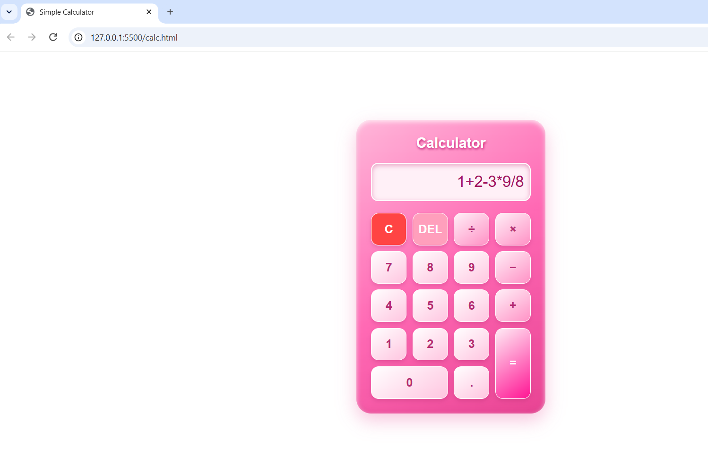

# Ex.No:06 JavaScript Calculator
## Date: 23-11-2026
## AIM

To design and develop a simple calculator using HTML, CSS, and JavaScript to perform basic arithmetic operations such as addition, subtraction, multiplication, and division.

## ALGORITHM

1. Create an HTML page to design the calculator interface.
2. Create a display field to show the numbers and calculation results.
3. Create buttons for digits from 0 to 9 and arithmetic operators.
4. Use CSS to arrange and style the calculator buttons and display.
5. Write JavaScript functions to handle button clicks.
6. Store the entered numbers and operators in the calculator display.
7. Use JavaScript to evaluate the arithmetic expression.
8. Display the calculated result on the calculator screen.
9. Provide a clear button to reset the calculator.
10. Test the calculator with different arithmetic operations.

## PROGRAM

# .html
```

<!DOCTYPE html>
<html lang="en">
<head>
    <meta charset="UTF-8">
    <meta name="viewport" content="width=device-width, initial-scale=1.0">
    <title>Simple Calculator</title>
    <link rel="stylesheet" href="style.css">
</head>
<body>

    <div class="calculator">
        <h2>Calculator</h2>

        <input type="text" id="display"
        placeholder="0" readonly>

        <div class="buttons">
            <button class="clear" onclick="clearDisplay()">C</button>
            <button class="delete" onclick="deleteLast()">DEL</button>
            <button class="operator" onclick="appendValue('/')">÷</button>
            <button class="operator" onclick="appendValue('*')">×</button>

            <button onclick="appendValue('7')">7</button>
            <button onclick="appendValue('8')">8</button>
            <button onclick="appendValue('9')">9</button>
            <button class="operator" onclick="appendValue('-')">−</button>

            <button onclick="appendValue('4')">4</button>
            <button onclick="appendValue('5')">5</button>
            <button onclick="appendValue('6')">6</button>
            <button class="operator" onclick="appendValue('+')">+</button>

            <button onclick="appendValue('1')">1</button>
            <button onclick="appendValue('2')">2</button>
            <button onclick="appendValue('3')">3</button>
            <button class="equal" onclick="calculate()">=</button>

            <button class="zero" onclick="appendValue('0')">0</button>
            <button onclick="appendValue('.')">.</button>
        </div>
    </div>

    <script src="script.js"></script>
</body>
</html>
```

# style.css
```

* {
    margin: 0;
    padding: 0;
    box-sizing: border-box;
}

body {
    font-family: Arial, sans-serif;
    background: white;
    min-height: 100vh;
    display: flex;
    justify-content: center;
    align-items: center;
}

.calculator {
    width: 320px;
    padding: 25px;
    background: linear-gradient(
        145deg,
        #ffb6d9,
        #ff69b4,
        #e84393
    );
    border-radius: 25px;
    box-shadow:
        0 12px 30px rgba(232, 67, 147, 0.3),
        inset 0 3px 8px rgba(255,255,255,0.8),
        inset 0 -4px 8px rgba(180,30,100,0.2);
}

h2 {
    text-align: center;
    margin-bottom: 20px;
    color: white;
    text-shadow: 1px 2px 4px #c21870;
}

#display {
    width: 100%;
    height: 65px;
    margin-bottom: 20px;
    padding: 10px;
    font-size: 26px;
    text-align: right;
    border: 2px solid white;
    border-radius: 12px;
    background: #fff0f7;
    color: #a31560;
    box-shadow: inset 0 3px 8px #e9a3c5;
}

.buttons {
    display: grid;
    grid-template-columns: repeat(4, 1fr);
    gap: 10px;
}

button {
    height: 55px;
    border: 1px solid white;
    border-radius: 13px;
    background: linear-gradient(
        145deg,
        #ffffff,
        #ffc5e0
    );
    color: #b52b70;
    font-size: 20px;
    font-weight: bold;
    cursor: pointer;
    box-shadow: 0 4px 7px rgba(150,30,90,0.2);
}

button:hover {
    background: #ffe3f0;
}

.operator {
    background: linear-gradient(145deg, #ffeff7, #ff91c5);
}

.clear {
    background: #ff4444;
    color: white;
}

.delete {
    background: #ff9fbc;
    color: white;
}

.equal {
    background: linear-gradient(
        145deg,
        #ffecf5,
        #ff1493
    );
    color: white;
    grid-row: span 2;
    height: auto;
}

.zero {
    grid-column: span 2;
}

button:active {
    transform: scale(0.94);
}
```

# script.js
```

const display = document.getElementById("display");

function appendValue(value) {
    if (display.value === "Error") {
        display.value = "";
    }
    display.value += value;
}

function clearDisplay() {
    display.value = "";
}

function deleteLast() {
    display.value = display.value.slice(0, -1);
}

function calculate() {
    try {
        if (!display.value || !/^[0-9+\-*/.() ]+$/.test(display.value)) {
            throw new Error();
        }

        const result = Function(
            '"use strict"; return (' + display.value + ')'
        )();

        if (!Number.isFinite(result)) {
            throw new Error();
        }

        display.value = result;
    } catch {
        display.value = "Error";
    }
}
```


## OUTPUT



## RESULT

Thus, a JavaScript-based calculator was successfully
designed and implemented to perform basic arithmetic
operations using HTML, CSS, and JavaScript.